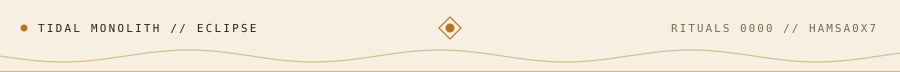
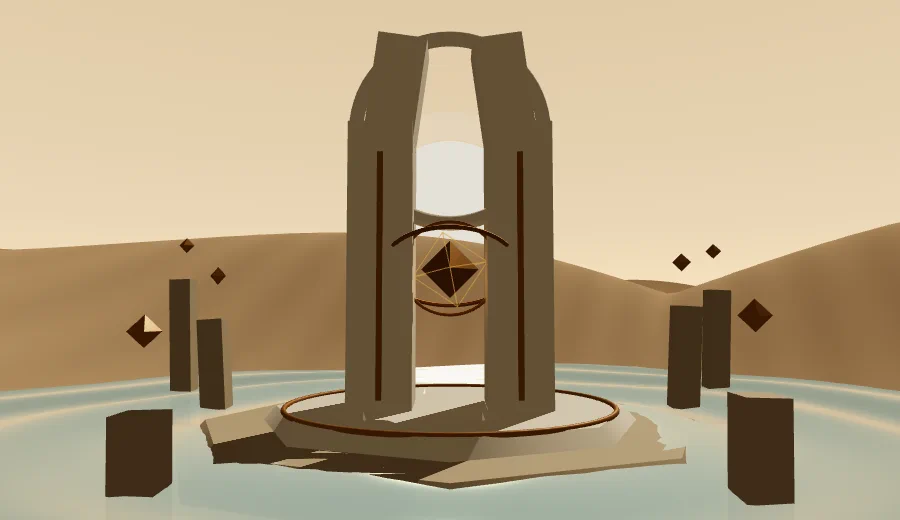

<picture><source media="(prefers-color-scheme: dark)" srcset="./assets/svg/horizon-dark.svg"></picture><a href="https://github.com/hamsa0x7/hamsa0x7/blob/main/views/sanctum.md"><picture><source media="(prefers-color-scheme: dark)" srcset="./assets/3d/main-surge-dark.webp"></picture></a>

<a href="https://github.com/hamsa0x7/hamsa0x7/blob/main/views/sanctum.md"><picture><source media="(prefers-color-scheme: dark)" srcset="./assets/svg/tile-sanctum-dark.svg"></picture></a><a href="https://github.com/hamsa0x7/hamsa0x7/blob/main/views/submerged.md"><picture><source media="(prefers-color-scheme: dark)" srcset="./assets/svg/tile-submerged-dark.svg"></picture></a><a href="https://github.com/hamsa0x7/hamsa0x7/blob/main/views/relic.md"><picture><source media="(prefers-color-scheme: dark)" srcset="./assets/svg/tile-relic-dark.svg"></picture></a>

<a href="https://github.com/hamsa0x7/hamsa0x7/issues/new?title=shrine:calm&body=Return+the+basin+to+stillness."><picture><source media="(prefers-color-scheme: dark)" srcset="./assets/svg/tile-state-calm-dark.svg"></picture></a><a href="https://github.com/hamsa0x7/hamsa0x7/issues/new?title=shrine:surge&body=Raise+the+tidal+resonance."><picture><source media="(prefers-color-scheme: dark)" srcset="./assets/svg/tile-state-surge-dark.svg"></picture></a><a href="https://github.com/hamsa0x7/hamsa0x7/issues/new?title=shrine:eclipse&body=Align+the+celestial+eclipse."><picture><source media="(prefers-color-scheme: dark)" srcset="./assets/svg/tile-state-eclipse-dark.svg"></picture></a>

