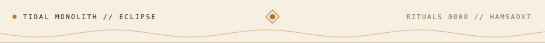
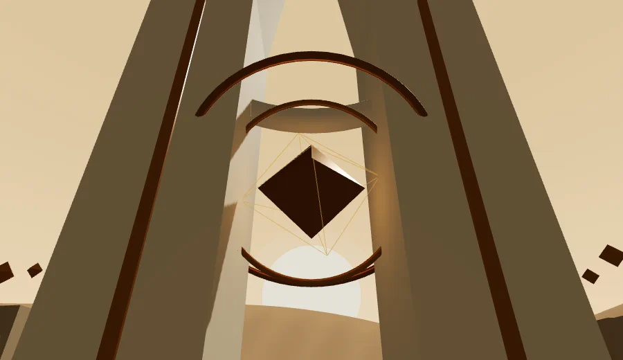
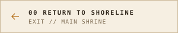
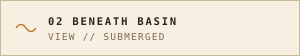
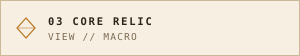

<picture><source media="(prefers-color-scheme: dark)" srcset="../assets/svg/horizon-dark.svg"></picture><a href="./relic.md"><picture><source media="(prefers-color-scheme: dark)" srcset="../assets/3d/sanctum-calm-dark.webp"></picture></a>

<a href="https://github.com/hamsa0x7"><picture><source media="(prefers-color-scheme: dark)" srcset="../assets/svg/tile-return-dark.svg"></picture></a><a href="./submerged.md"><picture><source media="(prefers-color-scheme: dark)" srcset="../assets/svg/tile-submerged-dark.svg"></picture></a><a href="./relic.md"><picture><source media="(prefers-color-scheme: dark)" srcset="../assets/svg/tile-relic-dark.svg"></picture></a>

